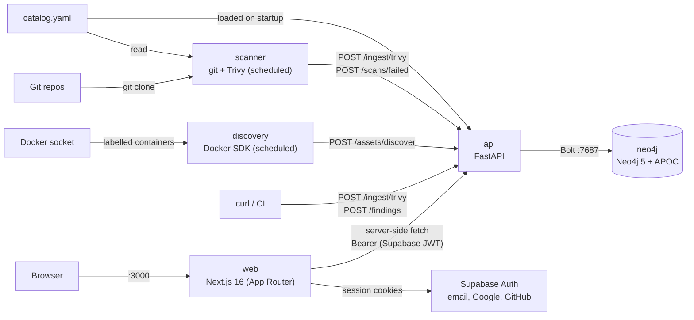

# ASPM

Application Security Posture Management: connects **vulnerable code** to the **production assets it exposes**, stores it as a graph, and ranks every finding by real-world risk.

> Which internet-facing production assets are exposed by which vulnerable code, and where did that vulnerability come from?

## Architecture



| Service | Tech | Port | Role |
|---|---|---|---|
| `neo4j` | Neo4j 5.24 community + APOC | 7474 (browser), 7687 (bolt) | Stores the attack-path graph; uniqueness constraints on every node key |
| `api` | Python 3.14, FastAPI, neo4j driver | 8000 | Ingest, query, risk scoring, API-key auth |
| `web` | Next.js 16, React 19, Tailwind v4, shadcn/ui, react-force-graph-2d | 3000 | Server-rendered UI behind Supabase login; all data fetching happens on the Next.js server |
| `scanner` | Python 3.14, git, Trivy 0.74, Semgrep | — | Clones every catalog repository on a schedule, runs Trivy and Semgrep (plus `trivy image` for catalog assets with an `image`), posts each report as a scan run |
| `discovery` | Python 3.14, Docker SDK | — | Lists running containers labelled `aspm.environment` on a schedule and posts them as assets |

### Data model

```
(:Repository {name, url, language})
    -[:CONTAINS]->
(:Vulnerability {id, cve, severity, description, status})
    -[:AFFECTS]->
(:Asset {name, environment, type, internet_facing, source})

(:Repository)-[:DEPLOYS_TO]->(:Asset)
```

- `DEPLOYS_TO` comes from `catalog.yaml` or from Docker discovery. A finding in a repository `AFFECTS` every asset that repository deploys to, so scanners only need the repo name.

- Keys (`Repository.name`, `Vulnerability.id`, `Asset.name`) are unique-constrained and normalized on ingest (whitespace collapsed; repo/asset names lower-cased, vulnerability ids upper-cased), so re-ingesting merges instead of duplicating.
- A *finding* is one `Repository → Vulnerability → Asset` chain.

### Data ownership

Every `Repository`, `Vulnerability`, `Asset` and `Scan` node carries an `owner` property (the Supabase user id). Keys are unique per owner, so two users can both have a repository called `api`. Every `GET` route and `PATCH /findings/{id}` only sees the signed-in user's nodes; another user's finding returns 404.

Machine routes (`POST`, `X-API-Key`) write for the owner given in the `?owner=` query parameter, or `ASPM_DEV_OWNER` when it is omitted; with neither they return 422. On startup, if `ASPM_DEV_OWNER` is set, the API assigns any node that has no owner to it and loads `catalog.yaml` for it. Find your id in the Supabase dashboard (Authentication → Users → user UID). This is a bridge until users connect their own GitHub repositories (`frontend/ai-docs/multi-tenant-github-app-plan.md`).

### Request flow

1. The `scanner` service (or any other client) `POST`s a scanner report or a manual finding to the API with an `X-API-Key` header.
2. The API validates and normalizes it, then `MERGE`s it into Neo4j.
3. A browser request hits the Next.js server, which calls the API server-side (the API key never reaches the browser) and renders the page.

### Risk scoring

Each finding gets a 0–100 score and a P1–P4 priority, computed in the API per vulnerability → asset pair:

**score = severity × environment × exposure**, normalized so CRITICAL + production + internet-facing = 100.

| Factor | Weights |
|---|---|
| Severity | CRITICAL 10 · HIGH 7 · MEDIUM 4 · LOW 1 |
| Environment | production 1.0 · staging/uat/qa 0.6 · development/test 0.3 · unknown 0.6 |
| Exposure | internet-facing 1.5 · internal 1.0 |

Priority: **P1** ≥ 70 · **P2** ≥ 40 · **P3** ≥ 20 · **P4** < 20.

## Quick start (Docker, whole stack)

Requires Docker Desktop.

```bash
cp .env.example .env
```

Set `ASPM_API_KEY` in `.env` to a random value (e.g. `python -c "import secrets;print(secrets.token_urlsafe(32))"`) and fill in the two Supabase values (see Configuration), then:

```bash
docker compose up -d --build
```

| URL | What |
|---|---|
| http://localhost:3000 | Web UI (sign in or create an account on `/signup`) |
| http://localhost:8000/docs | API docs (Swagger); click **Authorize** and paste the key (machine routes) or a Supabase access token (user routes) |
| http://localhost:7474 | Neo4j browser (`neo4j` / `aspm_dev_password`) |

Startup order is enforced by health checks: `neo4j` → `api` → `web` and `scanner`. The scanner scans every repository in `catalog.yaml` once on start, then every `SCAN_INTERVAL_MINUTES`. On first start the API creates the constraints; the graph starts empty. To load sample data, see [`demo/README.md`](demo/README.md) (`docker compose --profile demo up -d`).

Stop with `docker compose down` (add `-v` to also delete the graph data).

### Configuration (`.env`)

| Variable | Default | Used by |
|---|---|---|
| `ASPM_API_KEY` | *(required)* | `api` (validates on machine routes), `scanner` and `discovery` (send) |
| `NEO4J_PASSWORD` | `aspm_dev_password` | `neo4j` (only applied when the data volume is first created), `api` |
| `API_PORT` | `8000` | Host port for `api` |
| `WEB_PORT` | `3000` | Host port for `web` |
| `ASPM_DEV_OWNER` | *(empty)* | `api`: Supabase user id that owns machine-written data (catalog, scanner, discovery, demo seed); see Data ownership |
| `GITHUB_TOKEN` | *(empty)* | `scanner`: read-only token for private GitHub repositories (`contents: read`); never stored |
| `SCAN_INTERVAL_MINUTES` | `360` | `scanner`: minutes between scan rounds |
| `SCAN_ON_START` | `true` | `scanner`: scan immediately on start instead of waiting one interval |
| `DISCOVERY_INTERVAL_MINUTES` | `15` | `discovery`: minutes between Docker discovery rounds |
| `NEXT_PUBLIC_SUPABASE_URL` | *(required)* | `web` build arg: Supabase Project URL, no trailing `/`; also passed to `api` as `SUPABASE_URL` to verify login tokens |
| `NEXT_PUBLIC_SUPABASE_PUBLISHABLE_KEY` | *(required)* | `web` build arg: Supabase publishable (or legacy `anon`) key; baked into the image, so rebuild `web` after changing it |

## Local development (recommended for coding)

Neo4j runs in Docker; the API and the web app run on your machine with hot reload, so saved changes show up immediately. Use this instead of the full-Docker quick start while developing.

### Prerequisites

| Tool | Version | Check |
|---|---|---|
| Git | any recent | `git --version` |
| Docker Desktop (engine running) | any recent | `docker run --rm hello-world` |
| Python | 3.14 | `py -3.14 --version` |
| Node.js / npm | latest LTS / latest | `node -v`, `npm -v` |

### 1. Environment files (not in git, create them once)

The same `ASPM_API_KEY` must be in `.env` and `backend/.env`, otherwise the scanner and discovery get 401. The Supabase Project URL must match in all three files, otherwise every page gets 401. Generate one with `python -c "import secrets;print(secrets.token_urlsafe(32))"`.

| File | Create from | Set |
|---|---|---|
| `.env` | `cp .env.example .env` | `ASPM_API_KEY`, `NEXT_PUBLIC_SUPABASE_URL`, `NEXT_PUBLIC_SUPABASE_PUBLISHABLE_KEY`, `ASPM_DEV_OWNER` (your Supabase user id); leave `NEO4J_PASSWORD` as is |
| `backend/.env` | `cp backend/.env.example backend/.env` | `ASPM_API_KEY` (same value), `SUPABASE_URL` (Supabase Project URL), `ASPM_DEV_OWNER` (your Supabase user id) |
| `frontend/.env.local` | `cp frontend/.env.local.example frontend/.env.local` | `NEXT_PUBLIC_API_URL=http://localhost:8000`, `NEXT_PUBLIC_SUPABASE_URL`, `NEXT_PUBLIC_SUPABASE_PUBLISHABLE_KEY` |

(PowerShell: use `Copy-Item` instead of `cp`.)

### 2. Run it (three terminals)

**Terminal 1: database** (from the repo root; wait until `docker compose ps` shows `healthy`)

```bash
docker compose up -d neo4j
```

**Terminal 2: backend** (http://localhost:8000/docs)

```bash
cd backend
py -3.14 -m venv venv
venv\Scripts\Activate.ps1      # PowerShell; Git Bash: source venv/Scripts/activate
pip install -r requirements.txt
uvicorn main:app --reload --port 8000
```

**Terminal 3: frontend** (http://localhost:3000)

```bash
cd frontend
npm install
npm run dev
```

The API refuses to start without `ASPM_API_KEY` or `SUPABASE_URL`. If PowerShell blocks `Activate.ps1`, run `Set-ExecutionPolicy -Scope CurrentUser RemoteSigned` once.

### 3. Sample data and tests

- The graph starts empty. Load sample data (needs the `.env` file from step 1): `docker compose run --rm demo-seed`. See [`demo/README.md`](demo/README.md).
- Backend tests (Neo4j must be running, venv active): `pip install -r requirements-dev.txt && pytest` from `backend/`.
- Frontend checks: `npm run lint` and `npm run build` from `frontend/`.
- The `scanner` service is not needed here; add data with the demo seed or the `curl` examples below.

### 4. Stop

`Ctrl+C` in the backend and frontend terminals, then `docker compose down` (add `-v` to also delete the graph data).

### Troubleshooting

| Symptom | Fix |
|---|---|
| Web pages show 401 or fetch errors | `SUPABASE_URL` in `backend/.env` differs from the frontend's Supabase URL, or the Supabase project still signs with the legacy JWT secret (Project Settings → JWT Keys) |
| Scanner or discovery get 401 | `ASPM_API_KEY` differs between `.env` and `backend/.env` |
| Backend cannot connect to Neo4j | Docker Desktop not running, or Neo4j not `healthy` yet |
| `pip install` fails on a package | It has no Python 3.14 build at the pinned version; raise its version in `requirements.txt` |
| Port 3000, 7474, 7687 or 8000 in use | Stop the other program, or change `API_PORT` / `WEB_PORT` |
| Neo4j login fails after changing `NEO4J_PASSWORD` | The password applies only on first volume creation; run `docker compose down -v` and start again |

## Getting data in

Automatic: list a repository in `catalog.yaml`. The `scanner` service clones it (shallow, catalog `branch`), runs `trivy fs`, and posts the report with the commit SHA. A clone, scan or upload that fails is recorded as a failed scan run and never auto-resolves findings; other repositories keep scanning. The scanner reads the catalog every round; restart `api` so it picks up new asset mappings too.

Manual:

Ingest a single finding:

```bash
curl -X POST http://localhost:8000/findings \
  -H "X-API-Key: <key>" -H "Content-Type: application/json" \
  -d '{"repository":{"name":"payments-service","url":"https://github.com/example-org/payments-service"},
       "vulnerability":{"id":"VULN-1001","cve":"CVE-2024-12345","severity":"CRITICAL","description":"SQL injection"},
       "asset":{"name":"prod-payments-api","environment":"production","type":"Kubernetes Service","internet_facing":true}}'
```

Declare repositories and where they run in `catalog.yaml` (repo root). The API loads it on startup (`CATALOG_PATH`, mounted read-only in compose); `POST /catalog` applies the same structure as JSON. Each listed repository's `DEPLOYS_TO` edges are replaced by its `assets` list, and existing findings are linked to newly added assets. Set `assets: []` to unmap a repository.

Running containers can register themselves instead. The `discovery` service reads the Docker socket (mounted read-only) and posts every container with an `aspm.environment` label to `POST /assets/discover`. The container name becomes the asset name, `aspm.internet_facing` (`"true"` / `"false"`) sets exposure, and `org.opencontainers.image.source` is matched against repository URLs (case, trailing `/` and `.git` ignored) to add `DEPLOYS_TO`. Discovered assets get `source: docker`, `status: active` and `last_discovered_at`. A Docker asset missing from a later round is marked `status: decommissioned` with `decommissioned_at` (its internet exposure and environment no longer raise finding risk) and becomes active again when it reappears. `api` and `web` carry these labels in `docker-compose.yml`.

```yaml
repositories:
  - name: my-repo
    url: https://github.com/org/my-repo
    language: Python
    branch: main
    assets:
      - name: prod-api
        environment: production
        type: Docker container
        internet_facing: true
```

Ingest a Trivy report for a catalog repository:

```bash
trivy fs --scanners vuln --format json . > trivy.json
curl -X POST "http://localhost:8000/ingest/trivy?repo_name=my-repo" \
  -H "X-API-Key: <key>" -H "Content-Type: application/json" --data-binary @trivy.json
```

For a repository not in the catalog, add `&repo_url=`; to link one extra asset explicitly, add `&asset_name=&asset_environment=&asset_type=&asset_internet_facing=` (all three of name, environment and type together).

Each Trivy post is one scan run. New findings start `open`; findings the run no longer reports (same repo and scanner) become `resolved`; a `resolved` finding that comes back is reopened. Statuses set by people (`in_progress`, `accepted_risk`, `false_positive`) are kept. Add `&commit=<sha>` to record the commit, and `&partial=true` for scans of part of a repo so nothing is auto-resolved. The response is `{scan_id, ingested, resolved, reopened, skipped, ids}`.

## API

`GET` routes and `PATCH /findings/{id}` need a signed-in user (`Authorization: Bearer <Supabase access token>`); the first request creates a `(:User)` node and status changes record `status_changed_by`. `POST` routes are for machines and need `X-API-Key`. `/health` is open.

| Method | Path | Description |
|---|---|---|
| `GET` | `/health` | Liveness |
| `POST` | `/findings` | Ingest one repository → vulnerability → asset chain (`scanner = manual`) |
| `GET` | `/findings` | Findings with risk, sorted by risk; `?status=` (default `open,in_progress`, `all` for everything); includes findings with no asset |
| `GET` | `/findings/{id}` | One vulnerability with its repositories, assets and per-asset risk |
| `PATCH` | `/findings/{id}` | Set status: `open`, `in_progress`, `resolved`, `accepted_risk`, `false_positive` |
| `GET` | `/assets` | Assets with open / in-progress vulnerability counts per severity and worst risk |
| `GET` | `/graph` | Graph as `{nodes, links}`; `?status=` like `/findings` |
| `GET` | `/scans` | Scan runs, newest first, with `status` (`succeeded` / `failed`); `?repo=`, `?limit=` |
| `GET` | `/scans/failing` | Repositories whose latest scan (per scanner) failed, with reason and last successful scan time |
| `POST` | `/scans/failed` | Record a failed scan run (`repo_name`, `scanner`, `error`, optional `repo_url`, `commit`, `detail`); never resolves anything |
| `POST` | `/ingest/trivy` | Ingest a Trivy JSON report as one scan run with auto-resolve; `?commit=`, `?partial=`; asset params optional |
| `POST` | `/ingest/semgrep` | Ingest a Semgrep JSON report the same way (SAST findings) |
| `POST` | `/catalog` | Upsert repositories and their `DEPLOYS_TO` assets; returns `{repositories, assets, linked, unlinked, backfilled}` |
| `GET` | `/catalog` | Every repository with its deployed assets, open count and last scan time |
| `POST` | `/assets/discover` | Upsert runtime assets `{source, assets: [{name, image, labels}]}` and link them to repositories by `org.opencontainers.image.source`; marks assets of the same `source` that were not posted `decommissioned`; returns `{assets, linked, unmatched, backfilled, decommissioned}` |

## UI

| Page | What it shows |
|---|---|
| `/login`, `/signup` | Email/password, Google and GitHub sign-in and sign-up; every other page redirects here when signed out |
| `/forgot-password`, `/reset-password` | Request a password reset link by email, then set a new password from it |
| Header | Current section, **Index** button (full-screen section list; keys `1`–`5` jump, `Esc` closes) and profile menu (name, email, Logout) |
| `/` | Findings table ranked by risk, severity summary tiles, status filter, first / last seen; red warning when a repository's latest scan failed |
| `/graph` | Interactive force-directed graph of the whole attack-path graph |
| `/findings/[id]` | Finding detail: description, risk, NVD link, status change, repo → vuln → asset path |
| `/assets` | Asset inventory ranked by risk |
| `/scans` | Scan history with result (done / failed with reason) and ingested / resolved / reopened counts |
| `/catalog` | Repositories, the assets each deploys to, and which are unmapped |

## Project layout

```
docker-compose.yml     neo4j + api + web + scanner + discovery (+ demo-seed under the demo profile)
.env.example           compose configuration
catalog.yaml           repositories and the assets they deploy to
demo/                  opt-in sample data: seed.cypher, purge.cypher, trivy-sample.json
scanner/
  run.py               scan loop: clone → Trivy → upload; records failures
  Dockerfile           python:3.14-slim + git + Trivy binary
discovery/
  run.py               discovery loop: labelled Docker containers → POST /assets/discover
  Dockerfile           python:3.14-slim + Docker SDK
backend/
  main.py              FastAPI app, API-key auth, routes
  db.py, models.py     Neo4j driver, Pydantic models
  risk.py, ingest.py   risk scoring, ingest and auto-resolve
  connectors/          Trivy and Semgrep report parsers
  Dockerfile
frontend/
  app/                 pages (App Router, Server Components), auth actions and routes
  proxy.ts             Supabase session refresh; redirects signed-out visitors to /login
  components/          UI components (graph, nav, badges, shadcn/ui)
  lib/                 shared types, graph helpers, API headers, Supabase server client
  Dockerfile           standalone Next.js build
```

## Current limitations

- Data is isolated per signed-in user, but only one user (`ASPM_DEV_OWNER`) receives scanner, discovery and catalog data until the GitHub App connection is built; anyone can sign up, there are no roles; reset emails only reach Supabase org members until custom SMTP is set up.
- Scanners: Trivy (dependencies and images) and Semgrep (code); no generic SARIF connector yet.
- No "Scan now" button yet; scans run on start and on the interval (`docker compose restart scanner` forces a round).
- Backend ingest lifecycle is covered by pytest (`cd backend && pip install -r requirements-dev.txt && pytest`, needs Neo4j running); no frontend tests or CI yet.
- Risk weights are hardcoded; no exploitability (EPSS/KEV) or asset-criticality input.
- Local-dev defaults (Neo4j password, plaintext `.env`) are not production-ready.
